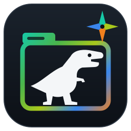
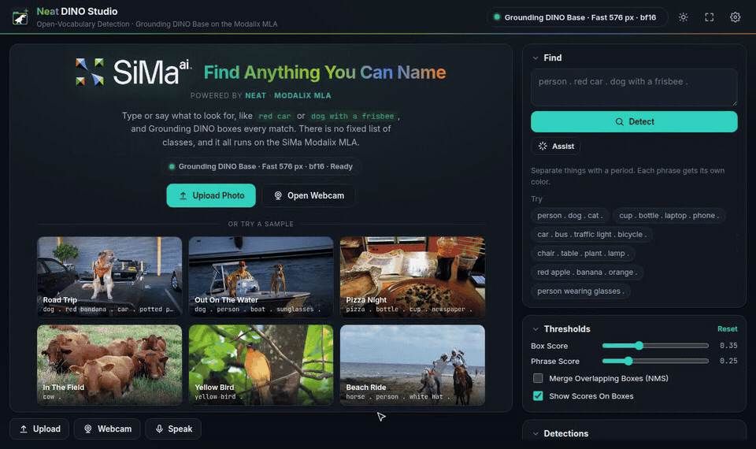
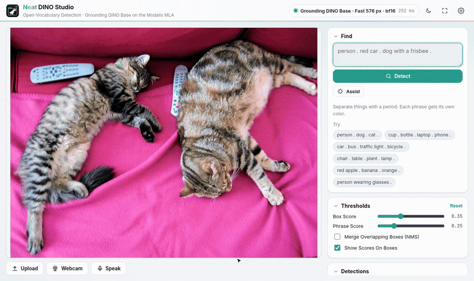
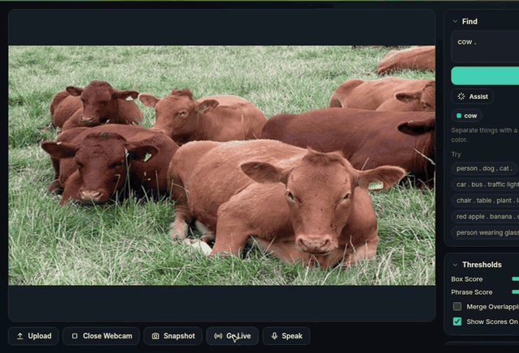

<p align="center"></p>

<h1 align="center">Neat DINO Studio</h1>

<p align="center">Open-vocabulary object detection with <a href="https://huggingface.co/IDEA-Research/grounding-dino-base">Grounding DINO</a> on the SiMa.ai Modalix MLA.<br>
Type or say what to find — <code>person . red car . dog with a frisbee .</code> — and get boxes, from a photo or a live webcam.</p>

<p align="center"></p>

<table>
<tr>
<td width="50%"></td>
<td width="50%"></td>
</tr>
<tr>
<td><b>Voice.</b> "Could you find the cats and the remote controls?" becomes <code>cat . remote control .</code>, Whisper and an LLM on the MLA.</td>
<td><b>Live.</b> The webcam with two frames in flight; time per image and FPS on top.</td>
</tr>
</table>

<sub>Recorded on a Modalix DevKit with the Fast (576 px) model. Sample photos: COCO val2017, CC BY 2.0 (see NOTICE).</sub>

**Weights:** [IDEA-Research/grounding-dino-base](https://huggingface.co/IDEA-Research/grounding-dino-base), the **Base** size of Grounding DINO: **232.3 M parameters** in total (Swin-B image backbone 86.9 M, BERT-base text encoder 108.9 M, feature enhancer, deformable decoder and heads 36.5 M), unchanged from the original and run in bf16. Apache-2.0.

## What it does

- **Any phrase, not a fixed class list.** Grounding DINO matches boxes to the words you type; each phrase gets its own color.
- **Photo or webcam.** Upload, paste or drop a photo, try one of the six samples, or open the webcam: take a full-resolution
  snapshot or go live. Changing only the prompt reruns on the same image without re-running the backbone.
- **Voice.** Click *Speak* and say what you want ("can you find the red cars and any dogs"): it stops listening when you
  stop talking, Whisper transcribes it and a small LLM turns it into `red car . dog .`, both on the MLA through LLiMa (~0.5 s).
- **Pipelined Live mode.** Two webcam frames are in flight: one runs on the MLA while the CPU samples
  the other, for ~27 % more frames per second than one at a time.
- **See where the time goes.** The strip above the image shows the time per image and in Live mode the
  frame rate, split into text, backbone, encoder and decoder (hover a part for its MLA / CPU share).
- **Thresholds on the fly.** Box and phrase score sliders filter on the page, without another run.
- **Model manager.** Download, verify, load and delete models from Hugging Face in Settings → Models. One detector runs on the MLA at a time.
  The voice models download from Settings → Voice.
- **Your camera and microphone.** Settings → Devices picks them, with a live preview and a level meter.
- **Two sizes.** *Fast* (576 px) for the webcam, *Accurate* (768 px) for small objects. Both are bf16.

## Install (Modalix DevKit)

```bash
cd /media/nvme
curl -fsSL https://raw.githubusercontent.com/dotimothy/neat-dino-studio/main/install.sh | bash
cd neat-dino-studio && ./setup.sh          # builds the runtime, fetches the Fast model, HTTPS cert, alias
neat-dino                                  # (new shell) then open https://<board-ip>:8092/
```

`setup.sh --fetch accurate|all` fetches more models; `webapp/run.sh --daemon` runs it in the
background and `webapp/run.sh --stop` stops it (freeing the MLA). `neat-dino update` updates in place.
The page also works over plain HTTP, but browsers only allow the webcam on HTTPS; the studio
serves both on the same port with a self-signed certificate (accept the warning once).

Requirements: the NEAT SDK on the DevKit (SimaLMM runtime `sima-lmm-dev`, Python 3 with numpy,
Pillow, Flask — the `~/pyneat` venv has them), cmake and g++. About 700 MB of free MLA memory:
stop other MLA apps first.

## How it runs on the MLA

Grounding DINO Base is 232.3 M parameters: a Swin-B backbone, a BERT-base text encoder and a
6+6-layer deformable transformer. Two parts of it do not map onto the MLA: multi-scale
deformable attention samples at data-dependent points (the MLA's GridSample handles maps up to
32 px wide, at ~0.3 µs a sample), and the two-stage query selection needs a top-900 over all
image tokens. So the network is cut into MLA ELFs, and the board's Arm cores do the rest:

| On the MLA (bf16 ELFs) | On the A65 cores |
|---|---|
| Text encoder (BERT + projection), once per prompt | Tokenizing, phrase masks, text position embedding |
| Swin-B as 9 ELFs (fused stages, window shifts inside) | Swin patch merging and the return to image order (6 gathers) |
| 7 encoder ELFs (fusion, text enhancer, deformable projections) | Deformable-attention sampling (NEON, 16 threads) |
| Decoder value maps + 12 decoder ELFs | Top-900 selection, reference-box updates, sine embeddings |

`runtime/` (`dino_rt`) runs the ELFs with SimaLMM's `MLAModelWithBuffer` and reads and writes
their bf16 buffers in place, so there are no copies through the EV74 between stages. The web
app (`webapp/server.py`) talks to it as a child process; unloading a model stops it cleanly.
`dino_rt` has two *slots*, each with its own device buffers bound to the same loaded ELFs
(SimaLMM shares an ELF loaded twice), so a second frame can start while the first is still
running; the MLA goes to the older frame first, and the CPU threads are split between the slots
that are sampling. Replies come back in request order.

| | Fast · 576 px | Accurate · 768 px |
|---|---|---|
| Per new image (board) | 0.33 s | 0.54 s |
| Prompt change, same image | 0.25 s | 0.41 s |
| Live (two frames in flight), runtime | 3.9 FPS | 2.3 FPS |
| COCO AP, board (500-image val subset) | 42.0 | 46.4 |
| COCO AP, FP32 PyTorch, same inputs | 41.7 | 45.8 |

The bf16 build on the MLA matches the FP32 model. See `report.md` for details.

## Build it yourself

Everything that produces the models is here:

```
model/dino_mla.py        Grounding DINO rebuilt in MLA-friendly ops, stage by stage (checked against HF)
model/backbone_plan.py   the window-layout Swin-B ELFs
model/export_onnx.py     ONNX per stage, with real inputs/outputs for board checks
compile/                 SiMa Model Compiler driver (bf16, MLA tessellation), probes, board checks
tools/make_bundle.py     ELFs + tables + constants -> a runtime bundle
tools/publish_hub.py     bundles -> Hugging Face (models.json)
runtime/                 dino_rt (C++, SimaLMM)
webapp/                  the studio (Flask + plain JS, no build step)
```

```bash
.venv/bin/python model/check_mirror.py --size 768           # the rebuild vs transformers, FP32
.venv/bin/python model/export_onnx.py --size 576 --all      # ONNX for every stage
compile/build_stages.sh 576                                 # compile them all (NEAT SDK container)
.venv/bin/python tools/make_bundle.py --size 576 --text     # bundles in build/bundles/
BOARD=sima@<board-ip> ./deploy.sh --models --build          # to a DevKit
```

## Voice (Whisper + LLiMa)

Settings → Voice → *Turn On* starts a sidecar (`voice/voice_server.py`): pyneat's GenAIServer with
Whisper Small (a16w8) and an LLM, on `127.0.0.1:9987`. Both run on the MLA next to the detector.
Click *Speak* and talk: recording stops after a short pause (0.8 s by default, adjustable in
Settings → Voice), or after 5 s if nothing was said. Holding *Speak* or the space bar records until
you let go instead.

1. The browser records WebM/Opus and posts it to `/api/voice/prompt`.
2. Whisper transcribes it (~0.3 s): "Can you find the red cars and any dogs?"
3. The LLM turns the request into phrases (~0.2 s): `red car . dog .`, also for indirect requests
   ("is there anything I could sit on" → `chair . sofa . bench . stool .`). Without an LLM,
   rules strip the request words and split on "and" and commas.
4. The prompt is filled in and the detection runs. In Live mode the next frame uses it.

The models are LLiMa folders in `/media/nvme/llima/models` (`--llima-models`), the ones NEAT
GenAI Studio downloads: `whisper-small-a16w8` and `Gemma-4-E2B-it-TextOnly-GPTQ-a16w4` (default,
best at indirect requests) or `LFM2.5-230M-a16w4` (~40 ms, literal requests only). If they are not
on the board, Settings → Voice downloads them from Hugging Face (`simaai/…`) into that folder, so
GenAI Studio can use them too; a stopped download resumes. Whisper alone is enough: without an LLM,
rules turn the request into phrases. The *Assist*
button uses the same LLM on typed text. Voice stays on across restarts until turned off.
The microphone, like the webcam, needs the page over HTTPS.

## License

Apache-2.0. Grounding DINO © IDEA Research (Apache-2.0); BERT and Swin weights as distributed
with it. Inter and JetBrains Mono fonts under the SIL Open Font License. The voice models
(Whisper, Gemma, LFM) are not part of this repository; they are installed separately under
their own licenses.
